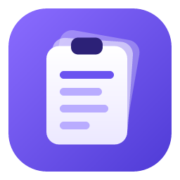

<p align="center">
  
</p>

<h1 align="center">ClipDeck</h1>

<p align="center">
  A lightweight, always-on clipboard manager for Windows, macOS and Linux.<br/>
  Copy many things, then press one shortcut and pick what to paste.
</p>

<p align="center">
  <b>Source-available, free for non-commercial use.</b>
  &nbsp;·&nbsp; <a href="LICENSE">PolyForm Noncommercial 1.0.0</a>
  &nbsp;·&nbsp; <a href="COMMERCIAL-LICENSE.md">Commercial licensing</a>
</p>

---

## Why

- Copying something new silently overwrites what you copied before.
- Built-in clipboard histories are thin. Windows' Win+V keeps about 25 items,
  drops items larger than ~4 MB and forgets everything on restart unless
  pinned; older macOS versions have none; Linux desktops vary.
- Screenshots and images copied from several places are the worst case.

ClipDeck keeps a local history of text, rich text, images and files and gives
you a fast, keyboard-friendly deck to paste any of it.

## Features

- **Captures everything you copy**: plain text, rich text (HTML/RTF), images
  and file lists, with the original formats preserved so rich text pastes as
  rich text and images paste as images.
- **Mission Control for your clipboard**: one shortcut lays your recent clips
  out as cards over a dimmed, blurred view of your screen, or in a window you
  can move and resize. Monochrome and keyboard-first, with search, filters,
  pins, Quick Look (<kbd>Space</kbd>) and spring-based motion that honours
  "reduce motion".
- **Pastes into the app you were using**: pick a clip and ClipDeck returns
  focus to the previous app and pastes it (Windows, and macOS once you allow
  Accessibility). On Linux it copies the clip and you press Ctrl+V.
- **Paste slots**: paste the latest nine clips directly with a shortcut,
  without opening the deck.
- **Paste queue**: turn queue mode on, copy several things, then each press
  of the deck shortcut pastes the next one in order.
- **Plain copy and paste are untouched.** ClipDeck listens for clipboard
  changes and registers its own shortcuts; it never hooks the keyboard.
- **Private by design**: no network access at all, honours the "don't record
  this" markers password managers use, per-app blocklist, pause, optional
  encryption at rest (Windows and macOS), automatic deletion after N days,
  clear on exit. See [PRIVACY.md](PRIVACY.md).
- **Fit for company laptops**: installs without administrator rights on every
  platform, runs fully offline, respects Windows' clipboard-history policy and
  can be configured by IT through Group Policy, Intune, a macOS configuration
  profile or a Linux policy file. See [docs/DEPLOYMENT.md](docs/DEPLOYMENT.md)
  (use in a business needs a [commercial license](COMMERCIAL-LICENSE.md)).
- **Light**: the always-on part is a small Rust process that waits for
  clipboard events; the deck's web view only exists while it is open.

## Install

Download from [Releases](https://github.com/angarkartanmay-ops/ClipDeck/releases).
Each release lists SHA-256 checksums in `SHA256SUMS.txt`.

**Windows 10 (1809+) or 11, x64 or ARM64**

- `ClipDeck_<version>_x64-setup.exe` (or `_arm64-setup.exe`): installs for
  your account only, no administrator rights needed.
- `ClipDeck_<version>_x64_en-US.msi`: installs for all users (administrator),
  for IT deployment.
- `ClipDeck_<version>_x64_portable.zip`: no installation; unzip and run.

ClipDeck uses the Microsoft Edge WebView2 Runtime (part of Windows 11; the
installer fetches it if missing).

**macOS 11 or later, Apple silicon or Intel**

Open `ClipDeck_<version>_universal.dmg` and drag ClipDeck to Applications, or
to the Applications folder in your home folder if you are not an
administrator. ClipDeck lives in the menu bar. To let it paste for you, allow
it under **System Settings › Privacy & Security › Accessibility** when it
asks; until then, choosing a clip copies it and you press ⌘V.

**Linux x86-64 (Ubuntu 22.04+, Debian 12+, Fedora and similar)**

`.deb` and `.rpm` packages, or the `.AppImage`, which runs without
installing anything. On Wayland, bind `clipdeck --toggle` to a shortcut in
your desktop's keyboard settings.

> **Unsigned builds:** until a release is code-signed, Windows SmartScreen
> may say "Windows protected your PC" (choose **More info › Run anyway**) and
> macOS may block the first launch (choose **Open Anyway** in **System
> Settings › Privacy & Security**). Check the checksum first.
> [docs/DEPLOYMENT.md](docs/DEPLOYMENT.md) covers these, silent installs and
> managed settings.

## Using ClipDeck

| Shortcut | Windows | macOS | Linux |
| --- | --- | --- | --- |
| Open/close the deck (or paste the next queued clip) | <kbd>Ctrl+Shift+V</kbd> | <kbd>⌃⌘V</kbd> | <kbd>Ctrl+Alt+V</kbd> |
| Toggle paste queue | <kbd>Ctrl+Shift+Q</kbd> | <kbd>⌃⌘B</kbd> | <kbd>Ctrl+Alt+B</kbd> |
| Paste clip 1–9 | <kbd>Ctrl+Alt+1</kbd>…<kbd>9</kbd> | <kbd>⌃⌘1</kbd>…<kbd>9</kbd> | off (set in Settings) |

In the deck (⌘ instead of Ctrl on macOS):

| Key | Action |
| --- | --- |
| <kbd>↑ ↓ ← →</kbd>, <kbd>Home</kbd>, <kbd>End</kbd> | Move |
| <kbd>Enter</kbd> / click | Paste |
| <kbd>Shift+Enter</kbd> | Paste as plain text |
| <kbd>Space</kbd> | Quick Look |
| <kbd>Ctrl+C</kbd> | Copy only (no paste) |
| <kbd>1</kbd>…<kbd>9</kbd> | Paste clip 1–9 in the current view |
| <kbd>P</kbd> / <kbd>Q</kbd> / <kbd>Del</kbd> (macOS <kbd>⌘⌫</kbd>) | Pin / queue / delete |
| type, or <kbd>/</kbd> | Search (then <kbd>Ctrl+P</kbd>, <kbd>Alt+1…9</kbd>, <kbd>Shift+Del</kbd>) |
| <kbd>Tab</kbd> | Next filter (All, Text, Images, Files, Pinned) |
| <kbd>Esc</kbd> | Clear search, then close |

All shortcuts can be changed in Settings (gear icon, or the tray/menu-bar
menu). History keeps 50 clips by default (up to 200) within a 500 MB disk
budget; the oldest unpinned clips go first and pinned clips are kept.

### Known limitations

- **Windows, elevated windows:** Windows does not let a normal app type into
  an app running as administrator. The clip is still put on the clipboard, so
  <kbd>Ctrl+V</kbd> works.
- **macOS:** pasting for you needs the Accessibility permission; newer macOS
  versions may also ask before ClipDeck can read the clipboard in the
  background (**Privacy & Security › Paste from Other Apps**). ClipDeck shows
  a notice with a button for each.
- **Linux:** choosing a clip copies it (no automatic paste), Wayland needs a
  desktop shortcut for `clipdeck --toggle`, the deck has a solid background
  instead of blur, and encryption at rest is not available.
- Apps that delay-render huge clipboard data (for example very large Excel
  ranges) can make a capture take a moment; ClipDeck reads it in the
  background and skips clips larger than the "Largest clip" setting.

## Building from source

See [CONTRIBUTING.md](CONTRIBUTING.md) for each platform's toolchain. In short:

```bash
npm install
npm run tauri build
```

Architecture notes are in [docs/ARCHITECTURE.md](docs/ARCHITECTURE.md), the
manual test plan in [docs/TESTING.md](docs/TESTING.md) and the IT guide in
[docs/DEPLOYMENT.md](docs/DEPLOYMENT.md). Security reports: [SECURITY.md](SECURITY.md).

## License

ClipDeck is **source-available, free for non-commercial use** under the
[PolyForm Noncommercial License 1.0.0](LICENSE). You may use, study, modify
and share it for any non-commercial purpose. It is not "open source" in the
OSI sense, because commercial use is not permitted without a separate license.

### Commercial licensing

Using ClipDeck in a business, for paid work, or selling or bundling it
requires a separate written license. Contact **angarkartanmay@gmail.com**.
See [COMMERCIAL-LICENSE.md](COMMERCIAL-LICENSE.md).

The name "ClipDeck" and the logo are trademarks of the author and may not be
used by forks; see [TRADEMARKS.md](TRADEMARKS.md). Third-party components and
their licenses are listed in [THIRD_PARTY_LICENSES.md](THIRD_PARTY_LICENSES.md).

## Disclaimer

ClipDeck is provided **"as is", without warranty of any kind**, as stated in
the license. The author is not liable for any damage or data loss arising
from its use.

A clipboard history can contain **sensitive data** such as passwords,
personal messages or financial details that you copied. ClipDeck stores it
on your device so you can paste it later. Review [PRIVACY.md](PRIVACY.md), use
the blocklist, pause and encryption options, and clear the history before
sharing your user account.

Copyright © 2026 Tanmay Angarkar.
